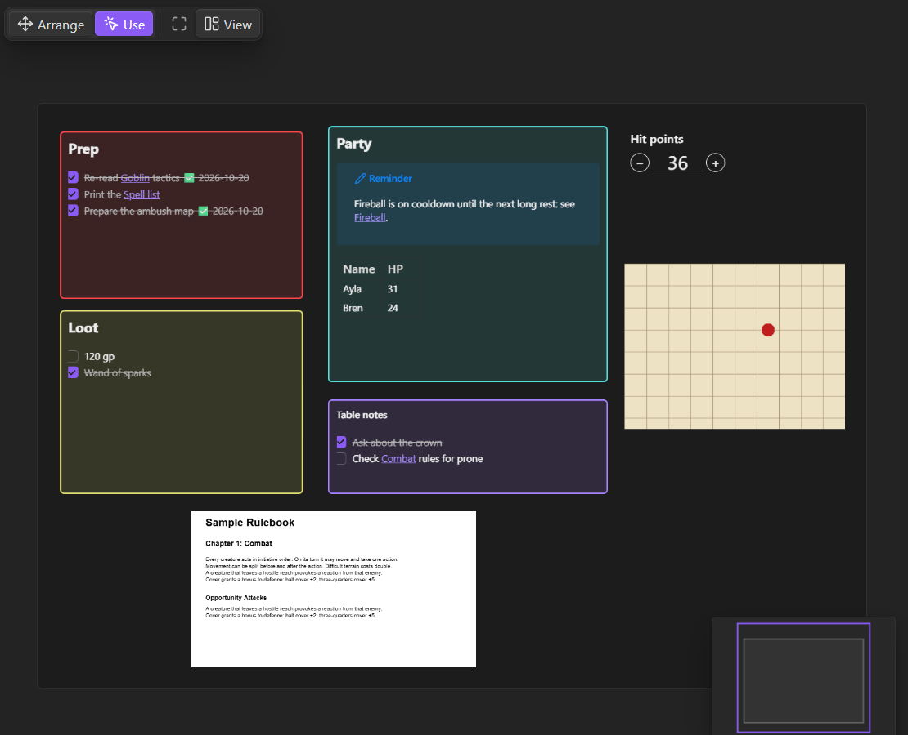

# Patchwork

Compose fixed-size pages from live pieces of your notes and PDFs, then export them to PDF or PNG.



A **patchwork** is a board of pages (A4, Letter, 16:9, custom sizes, and more). On each page you place **modules**: a section of a note, a cropped region of a PDF, an image, a text box, a table of contents or a tracker. Modules are live references, not copies. Edit the note or replace the PDF, and the page updates. When the layout is ready, export it as a print-ready PDF, as PNG images, or as a `.canvas`.

Good for game-master screens and handouts, cheat sheets and study cards, one-page summaries, and posters assembled from material you already keep in your vault.

## Features

- **Pages on an infinite board:** standard and custom page sizes, rulers, a grid, snapping, smart guides, a minimap, saved views and auto-arrange.
- **Live modules:** note sections (a heading, a block or a line range, set to clip, shrink or grow when the text doesn't fit), PDF regions (with a crop editor that shows the PDF's contents and searches its text), images, free Markdown text, a table of contents, text frames that flow across pages, and trackers (counters, boxes, checklists).
- **Layout tools:** an inspector and an outline, multi-select, align and distribute, lock, z-order, duplicate, undo and redo, master pages, page numbers, headers and footers, and a board font.
- **Keeps up with your vault:** renamed and moved files are followed, a note can be frozen as a snapshot, and you are warned when a PDF behind a crop is replaced.
- **Export:** PDF with vector text and vector PDF regions (or a smaller raster version), page ranges, sheet sizes with poster tiling, booklets, bleed and crop marks, bookmarks, page labels and a clickable table of contents. Also PNG, an ink saver option and `.canvas`.
- **Use mode:** the patchwork becomes a dashboard where links open to the side, and checkboxes and trackers can be clicked, but nothing moves.

## Getting started

1. In Obsidian, open **Settings → Community plugins → Browse**, search for **Patchwork**, then select **Install** and **Enable**.
2. Run **Patchwork: New patchwork** from the command palette, select the ribbon icon, or right-click a folder and choose **New patchwork**. You get a patchwork with one A4 page.
3. Drag notes, PDFs and images from the file explorer onto the page, or use the toolbar's **Note**, **PDF**, **Shape** and **More** buttons.
4. Select **Export** to write a PDF (or PNGs) next to the patchwork.

To install manually, download `main.js`, `manifest.json` and `styles.css` from the [latest release](https://github.com/aleMode/obsidian-plugin-patchwork/releases/latest) into `<your vault>/.obsidian/plugins/patchwork/`, then enable **Patchwork** under **Settings → Community plugins**.

## Using it

- **Toolbar:** switch between **Arrange** and **Use**, add a page or a module, zoom, undo and redo, open **Settings** for the whole patchwork, **Export**, and **View** (the outline and saved views, the minimap, the sidebar inspector).
- **Selecting:** a selected module shows a context bar above it, and `⋯` opens its properties. Double-click a text box or note to edit it in place, or a PDF region to crop it. In the crop editor, type a page number, zoom, use Page Up and Page Down, or double-click text to crop to its paragraph.
- **Moving:** drag pages and modules to move them, on a 5 mm grid. Hold Alt to place them freely. Right-click for more: crop, freeze, continue in a new frame, z-order, zoom to page, export this page and delete.
- **Copy and paste:** Ctrl/Cmd+C, X and V work on modules, also between patchworks. Pasted text becomes a text box, and a pasted image is saved as an attachment.
- **Navigating:** pan with the scroll wheel, by dragging empty space, or by holding Space. Zoom with Ctrl+wheel or a pinch. Ctrl/Cmd+0 zooms to fit, and Ctrl/Cmd+1 zooms to 100%.
- **View → Keyboard and mouse** lists every shortcut.

## Requirements and limitations

- **Desktop only** (Windows, macOS, Linux). PDF export uses Electron's print engine, which the mobile apps don't have.
- Obsidian 1.6.7 or later.
- Pages are fixed in size. Text doesn't reflow from one page to the next unless you link text frames.

## Privacy and permissions

- **No network access.** Patchwork makes no network requests and has no telemetry, ads or account.
- **Stays in your vault.** It reads the notes, PDFs and images you place on a patchwork. It writes `.patchwork` files, exported PDFs and PNGs, and pasted images, all inside your vault.
- **Clipboard:** used only when you copy or paste modules.
- **Electron:** to export PDFs at exact page sizes, Patchwork calls Chromium's `printToPDF` through `@electron/remote`. This is the only Electron API it uses, and the reason the plugin is desktop only.

## File format

A `.patchwork` file is JSON. Positions and sizes are stored in millimetres. Patchwork keeps any keys it doesn't recognise when it saves. If a file can't be read, Patchwork shows the error and the raw text, and never overwrites the file.

## Credits

Bundled with the plugin (licences are included at the end of `main.js`):

- [@cantoo/pdf-lib](https://github.com/cantoo-scribe/pdf-lib) (MIT) for assembling exported PDFs, with its dependencies [fflate](https://github.com/101arrowz/fflate), [culori](https://github.com/Evercoder/culori), [html-entities](https://github.com/mdevils/html-entities) and [node-html-better-parser](https://github.com/Sharcoux/node-html-parser) (all MIT), and [tslib](https://github.com/microsoft/tslib) (0BSD).

PDF rendering uses the copy of [PDF.js](https://mozilla.github.io/pdf.js/) that ships with Obsidian.

## Development

Requirements: Node.js 24 and Obsidian desktop.

```sh
npm install
npm run dev        # watch build into test-vault/.obsidian/plugins/patchwork/
npm run build      # type-check and production build (main.js at the repo root)
npm run check      # build, lint and tests: what CI runs
npm run e2e        # end-to-end suites in scripts/e2e/ against a running dev Obsidian
npm run fixtures   # regenerate the binary fixtures in test-vault/
```

Open `./test-vault` as a vault in Obsidian, and choose **Trust author and enable plugins** the first time. After a rebuild, run **Reload app without saving** from the command palette. `scripts/launchObsidian.sh` (or `scripts/launchObsidian.ps1` on Windows) starts Obsidian on the test vault with an isolated profile and remote debugging on port 9222, which the end-to-end and performance scripts (`scripts/perf/`, results in `docs/perf.md`) use.

Design and scope are in [`SPEC.md`](SPEC.md). Notes, QA steps and reviews are in [`docs/`](docs/).

Releasing: run `npm version <x.y.z>` (this updates `manifest.json` and `versions.json`, and tags without a `v`), then `git push --follow-tags`. The release workflow builds the plugin, attests it, and drafts a GitHub release with `main.js`, `manifest.json` and `styles.css`. Add notes and publish it.

## Licence

[MIT](LICENSE)
